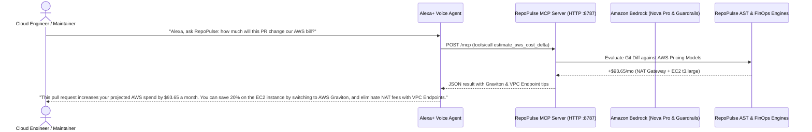

# 🎙️ RepoPulse AI • Alexa+ Model Context Protocol (MCP) Integration

> **Build, Ship, Shape: Amazon Developer Hackathon — Alexa+ Track**

RepoPulse AI turns **Alexa+** into an autonomous cloud maintainer and FinOps copilot. By implementing the open **Model Context Protocol (MCP)** specification over Streamable HTTP (`POST /mcp`), Alexa+ can seamlessly discover, invoke, and summarize complex code reviews, AWS Well-Architected audits, and cloud cost calculations completely through natural voice.

---

## 🏛️ Alexa+ Architectural Flow



---

## 🗣️ Supported Voice Interaction Scenarios

### Scenario 1: AWS Well-Architected Security Audit
* **Developer**: *"Alexa, ask RepoPulse if my latest AWS CDK stack has any security risks."*
* **Alexa+ Tool Call**: `aws_audit_iac({ diffText: "..." })`
* **Alexa+ Spoken Response**:  
  > *"I inspected your CDK stack. RepoPulse gave it a security score of 50 out of 100 because of two critical issues: a wildcard IAM policy granting all actions on all resources, and port 22 open to 0.0.0.0/0 on your security group. I've sent the remediation patch to your RepoPulse Studio."*

### Scenario 2: Cloud FinOps Spend Delta
* **Developer**: *"Alexa, ask RepoPulse how much this PR will add to our AWS bill."*
* **Alexa+ Tool Call**: `estimate_aws_cost_delta({ diffText: "..." })`
* **Alexa+ Spoken Response**:  
  > *"This changeset will add an estimated $93.65 per month to your AWS bill from a new NAT Gateway and a t3.large instance. RepoPulse recommends switching the instance to Graviton t4g.large to save $11.74 every month."*

### Scenario 3: Amazon Bedrock Guardrail Leak Defense
* **Developer**: *"Alexa, ask RepoPulse if there are any leaked AWS credentials in PR #42."*
* **Alexa+ Tool Call**: `apply_bedrock_guardrail({ text: "..." })`
* **Alexa+ Spoken Response**:  
  > *"Alert: Amazon Bedrock Guardrails blocked this commit. It detected a hardcoded AWS Access Key ID starting with A-K-I-A. The credential has been automatically redacted."*

---

## ⚡ Connecting RepoPulse to Alexa+

### 1. Launch the Streamable HTTP MCP Server
```bash
# Starts the stateless Streamable HTTP server on port 8787
npx repo-pulse serve-mcp-http --port 8787
```

### 2. Verify Endpoint Health
```bash
curl http://localhost:8787/health
# Returns: {"status":"healthy","transport":"streamable-http","server":"repo-pulse-ai","version":"2.4.0"}
```

### 3. Register Toolset with Alexa+
Provide the manifest at [`assets/alexa-plus-tools.json`](../assets/alexa-plus-tools.json) to your Alexa+ developer console or local agent bridge. Alexa+ will automatically register the four core developer tools:
1. `review_pull_request_diff`
2. `aws_audit_iac`
3. `estimate_aws_cost_delta`
4. `apply_bedrock_guardrail`

---

## 🏆 Why This Wins the Alexa+ Track

1. **Native Open Standards Alignment**: Completely adheres to the Model Context Protocol (MCP 2025-11-25) specification without vendor lock-in.
2. **Real Enterprise Utility**: Brings mission-critical cloud governance and FinOps to hands-free voice devices, freeing developers from manual dashboard hunting.
3. **Multi-Track Synergy**: Connects the **Alexa+ Track**, the **AWS Builder Track** (Amazon Bedrock & Nova), and the **Open Source Track** into one cohesive developer product.
