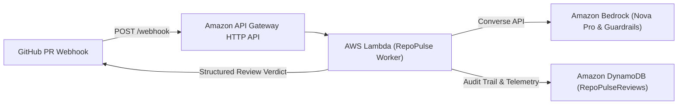

# ☁️ RepoPulse AI • AWS Cloud-Native Deployment (CDK v2)

Deploy the autonomous **RepoPulse AI** maintainer harness into your AWS Account in under 5 minutes.

## 🏛️ Architecture Overview



- **Amazon API Gateway HTTP API**: Serverless, low-cost HTTP webhook intake.
- **AWS Lambda Function**: Processes diffs using AST slicing, IaC security scanning, and FinOps pricing.
- **Amazon Bedrock (Nova Pro / Lite)**: Generates actionable PR reviews using the native Converse API.
- **Amazon Bedrock Guardrails**: Enforces zero-credential leakage and defends against prompt injections.
- **Amazon DynamoDB**: Maintains review history and token budgets with continuous backups (PITR).

---

## ⚡ 1-Click Deployment Instructions

### Prerequisites
1. AWS CLI installed and configured (`aws configure` or `aws sso login`).
2. Node.js 18+ and npm installed.

### 1. Build TypeScript Distribution
```bash
npm install
npm run build
```

### 2. Synthesize CloudFormation Template
```bash
# Verify the generated CloudFormation template
node -e "const { RepoPulseCdkStack } = require('./dist/infra/repopulse-cdk-stack.js'); const s = new RepoPulseCdkStack(null, 'stack'); console.log(JSON.stringify(s.toCloudFormationTemplate(), null, 2));" > cdk.out.json
```

### 3. Deploy via AWS CloudFormation CLI
```bash
aws cloudformation deploy \
  --template-file cdk.out.json \
  --stack-name RepoPulseAiStack \
  --capabilities CAPABILITY_IAM \
  --parameter-overrides GitHubWebhookSecret="my-secure-webhook-secret" \
  --region us-east-1
```

### 4. Configure GitHub Webhook
1. Go to your GitHub repository $\rightarrow$ **Settings** $\rightarrow$ **Webhooks** $\rightarrow$ **Add webhook**.
2. Set **Payload URL** to the `WebhookUrl` output from the CloudFormation stack.
3. Set **Content type** to `application/json`.
4. Set **Secret** to your chosen webhook secret.
5. Select **Let me select individual events** $\rightarrow$ check **Pull requests**.
6. Click **Add webhook**.

Every incoming Pull Request will now be automatically analyzed by **Amazon Bedrock Nova Pro** with **AWS FinOps Cost Delta** and **AWS IaC Security** audits!
